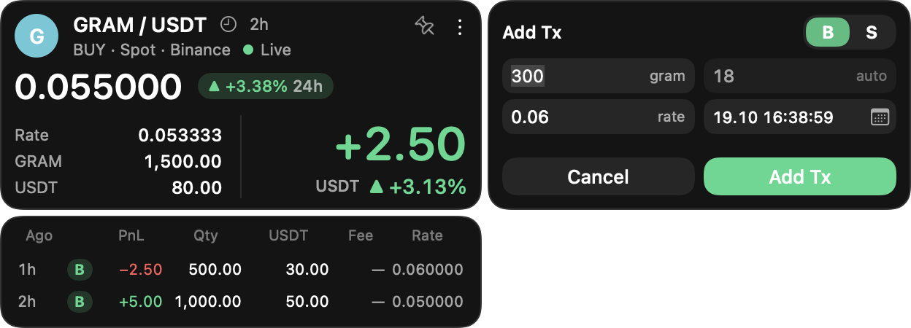
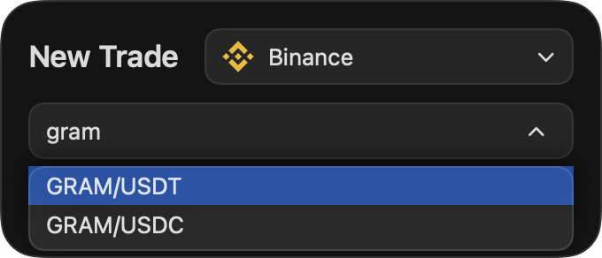
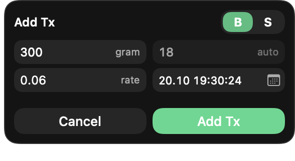
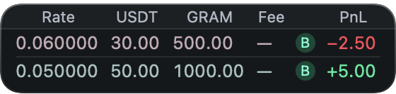
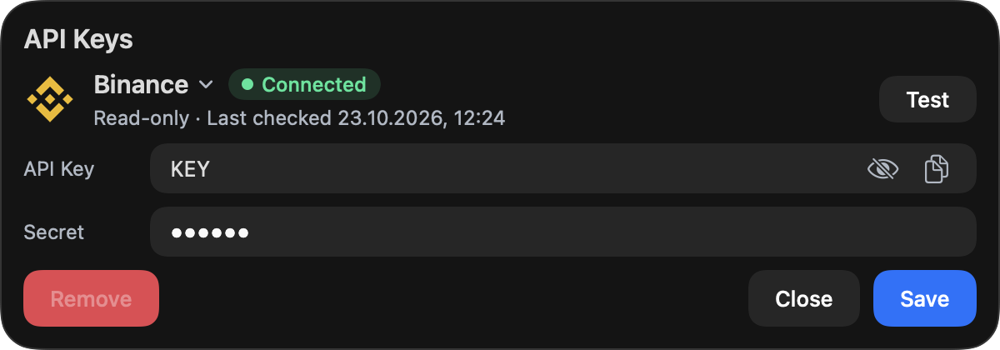
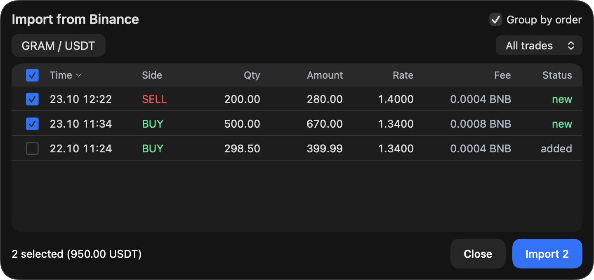
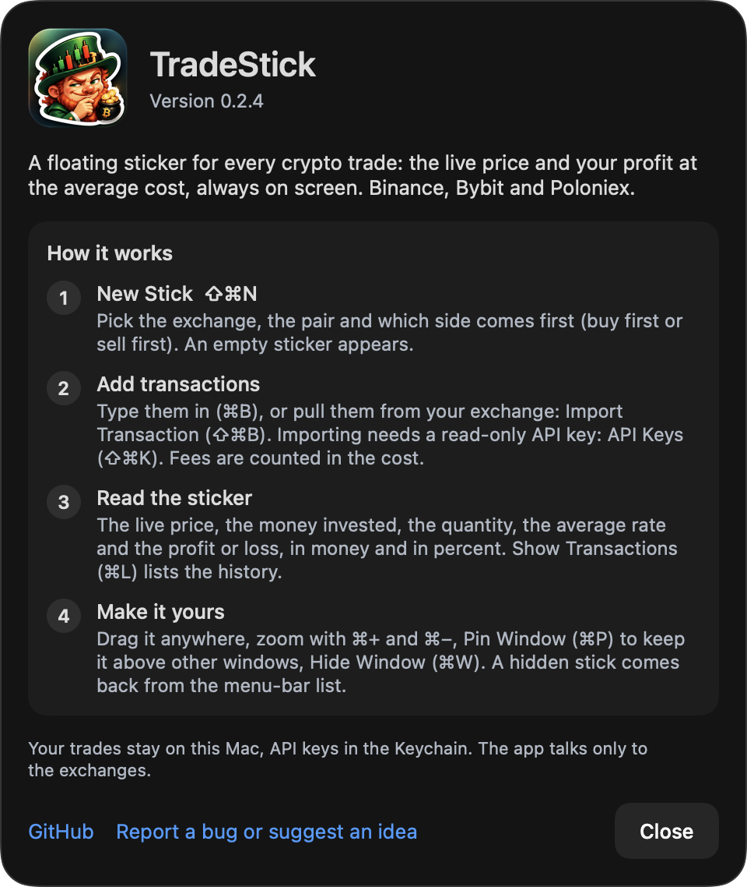

# TradeStick

**A floating sticker on your desktop for every crypto trade you hold — live price, and profit or loss at your average cost, always in sight.**



TradeStick lives in the macOS menu bar. Open a sticker per trade (say, GRAM / USDT on Binance), record what you bought and sold, and the sticker shows the live price, your average entry rate, what you hold, and your PnL in USDT and in percent. Stickers are small borderless windows you can drag anywhere, zoom, and pin on top of other windows.

Works with **Binance**, **Bybit** and **Poloniex** (spot). It only ever *reads*: your orders are never sent anywhere, and API keys, if you add any, are read-only and kept in the macOS Keychain.

## How it works

1. **Open a stick.** Menu bar icon → **New Stick** (⇧⌘N). Pick the exchange and the pair, and say whether the trade starts with a buy or a sell.

   

2. **Add what you did.** Right-click the sticker → **Add Transaction**: quantity and rate (or amount) — the third field is filled in for you. Time defaults to now; type another time or pick it in the calendar.

   

3. **Watch it.** The price updates live, PnL follows your average cost. **Show Transactions** unfolds the list under the sticker (double-click a row to edit it, the trash icon deletes it).

   

4. **Or import instead of typing.** Add a read-only API key (menu bar → **API Keys**, ⇧⌘K), then right-click a sticker → **Import Transaction**. Your fills come with their fees; tick the ones that belong to this trade. Fills the exchange sends are saved locally, so older history stays available even after the exchange stops returning it.

   
   

Handy: **⇧⌘N** New Stick · **⇧⌘K** API Keys · **⇧⌘R** Restart (after an update) · **⌘Q** Quit. Zoom a sticker from its right-click menu; Esc closes any dialog.

## Good to know

- Fees are part of the cost: a fee in BNB (or any other coin) is converted to the quote currency at the fill's rate, and counted.
- A sell-first trade (short) works the same way, with the roles reversed.
- Prices come from the exchanges' public feeds; if the connection drops, the sticker says so and reconnects by itself.
- No account, no cloud, no telemetry. Everything stays on your Mac.

## Install

```sh
brew install --cask caskbrew/tap/tradestick
```

That taps `caskbrew/homebrew-tap` automatically. To tap explicitly first:

```sh
brew tap caskbrew/tap
brew install --cask tradestick
```

Update and remove:

```sh
brew update && brew upgrade --cask tradestick
brew uninstall --cask tradestick          # keeps your data
brew uninstall --zap --cask tradestick    # also deletes ~/Library/Application Support/TradeStick
```

Requires macOS 15 (Sequoia) or newer. The app is not notarized; the cask removes the quarantine flag so it starts normally.

## Data

Your trades live in `~/Library/Application Support/TradeStick/tradestick.sqlite`.
Builds that are not the installed app (`swift run`, `.build/…`) use `TradeStick-Dev/` instead and never touch it.

## Build from source

```sh
swift build -c release
swift test
scripts/package.sh 0.1.0   # dist/TradeStick-0.1.0.zip + sha256 for the cask
```

## Dev vs installed

The installed app (`/Applications/TradeStick.app`, bundle id `com.caskbrew.tradestick`) and a dev build never share anything:

- data: `~/Library/Application Support/TradeStick/` vs `TradeStick-Dev/`; a dev build refuses to open the installed folder even via `TRADESTICK_DB`;
- settings: separate `UserDefaults` domains; the dev instance shows "DEV" in the menu bar;
- processes: run and restart dev only with `scripts/dev.sh`, which stops just the process started from `.build/`. Never `pkill TradeStick`;
- `.claude/settings.json` denies Claude Code `pkill`/`killall`/`kill` and any access to the installed app's data folder.

## Feedback

Found a bug or want something added? [Open an issue](https://github.com/caskbrew/TradeStick/issues).


